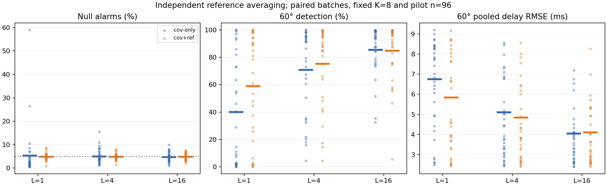

# Reference averaging and optical-delay measurement

A 45–60 minute integrated learning lab: does spending more acquisition time on a stored reference improve subsequent optical-delay measurements? Compare averages of **1, 4 and 16 independent lag estimates**, holding pilot length, calibration, camera and held-out events fixed.

## Objectives and prerequisites

Learn to derive reference covariance reduction, distinguish averaging statistics from averaging signals, measure conditional alarm behavior, and connect detector decisions to camera-based delay error. Prerequisites: covariance, conditional probability, least squares, Gaussian PSFs and basic Python. Suggested hour: 10 minutes prediction, 10 running and inspecting, 15 derivation, 15 annotated code, 10 exercises.

```sh
git clone https://github.com/ahmetalpkilic/reference-averaging-optical-delay-learning-lab.git
cd reference-averaging-optical-delay-learning-lab
sh run_demo.sh
```

Python 3.9–3.12. Initial dependency installation needs internet. One command creates a virtual environment, runs tests and produces `examples/results.json` and `examples/averaging.png`. Synthetic data only, seed 20261023, pinned dependencies; cross-platform last-bit differences are possible. No downloaded images or weights.

## Four-way connection

| Area | Physical or mathematical element | Measurement consequence |
|---|---|---|
| Optics | 550 nm Gaussian pupil and Fourier image formation | Known diffraction PSF shapes each spot |
| Camera | 16 mm focal length, 4 µm integrated pixels, read noise | Nonlinear subpixel localization |
| Vision / metrology | Spot motion and two correlated timing channels | Recover a 120 ms delay using alarm-selected GLS weights |
| Mathematics | Independent reference averages, covariance, conditional ranks | Quantify false alarms and optical-delay risk versus acquisition cost |

## Physical model and conventions


Use an untruncated paraxial Gaussian pupil amplitude `P(r)=exp(-r²/a²)` with amplitude radius a=1000 µm (1 mm). Fourier transformation and intensity squaring yield

`σ_sensor = λ f/(2πa)`, `σ_px = λ f/(2πap) ≈ 0.35014 px`.

This is an infinite-support apodized pupil, not a hard circular aperture. No Airy diameter or hard-aperture f-number is substituted. Positive image x points right; integer pixel centers run −16…16, with boundaries j±0.5. The 33×33 camera has zero skew/distortion and intrinsics `K_camera=[[4000,0,16],[0,4000,16],[0,0,1]]` in zero-based array coordinates. We use the 1-D marginal of the separable 2-D PSF; calibration size below is called K and is unrelated to camera intrinsics.

For known total marginal flux F=10000 signal units and background b=20 units/pixel,

`μ_j(c)=b+F[Φ((j+0.5−c)/σ)−Φ((j−0.5−c)/σ)]`.

Independent Gaussian read noise has SD 2 signal units/pixel. Shot noise, quantization, saturation and exposure integration are omitted. Flux here is an idealized signal amplitude, not a claim of photon-limited sensing. Fit c by least squares with known F, b, σ; analytic derivatives are checked against finite differences. With known `c0=.23 px`, `v=.8 px/s`, true delay `.12 s`, center is `.326 px`. Optical time is `(c_hat−c0)/v`. Fits outside the ±6 px ROI are rejected.

## Timing process


The event reference time is zero. Timestamp errors are `e_t=s Qθ x_t`, s=.02 s, where Q is a counterclockwise 2-D rotation and two independent stationary AR modes have correlations ρ=(0,.85). Recursion: `x_t=ρ x_(t−1)+sqrt(1−ρ²)z_t`, z standard normal. Each trace starts in stationarity. Thus `C=s²I` and `Γ_h=s²Qθ diag(ρ^h)Qθᵀ`. Physical channel labels remain fixed. Old traces have θ=0; pilots have θ=0 or 60°. Every trace contains n=96 observations.


Each batch has one covariance estimate from K=8 independent reset observations: `C_hat=Σ(z_i−z_bar)(z_i−z_bar)ᵀ/(K−1)`, in s². These calibration observations are not consecutive AR samples. All L values use this same C_hat. Each reference and pilot trace has n=96 samples. Each of 32 batches contains 200 null and 200 rotated-mode events.

## Derivation: average estimates, not traces

For reference trace ℓ, center its samples separately and estimate the symmetric lag matrix

`R_ℓ = [Σ_(t=1)^(n−1)(e_t−e_bar)(e_(t+1)−e_bar)ᵀ + transpose]/(2n)`.

Its units are s². Let `R_bar,L = (1/L) Σ R_ℓ`. The independent stationary reset traces have identically distributed lag matrices with mean μ_R and covariance `Σ_R=Cov(vec(R_ℓ))` in s⁴. Consequently

`E[R_bar,L]=μ_R`,

`Cov(vec(R_bar,L)) = (1/L²) Σ_(ℓ,k) Cov(vec(R_ℓ),vec(R_k)) = Σ_R/L`.

Independence removes the off-diagonal terms. Standard deviation falls as 1/√L. Centering and finite n bias the lag estimate relative to the population lag; averaging reduces variance but preserves that bias. Averaging the traces first is a different operation: independent zero-mean signal averages have lag magnitude reduced by L. The test with a two-trace counterexample prevents this mistake.

For independent pilot lag matrices P_i, let `d_i=vec(P_i−R_bar,L)`. For i≠j, conditional on the independently estimated C_hat,

`Cov(d_i,d_j | C_hat)=Σ_R/L`,

`Cov(d_i | C_hat)=Σ_P + Σ_R/L`.

The pilot noise floor remains even at infinite L. Set `W=C_hat^(−1/2)` by symmetric eigendecomposition and use `D_i=||W(P_i−R_bar,L)Wᵀ||_F`. W has units 1/s, so D is dimensionless. The shared whitened covariance becomes `(W⊗W)Σ_R(W⊗W)ᵀ/L`. Non-positive eigenvalues are rejected; no hidden ridge is applied.

This 1/L rule needs independence **between references**, not independence between time samples inside a trace. A longer single correlated trace has a different centered-lag estimator and finite-sample bias. Concatenating traces also introduces boundary pairs. Neither is equivalent to this experiment.

For an exchangeable scalar reference error with pairwise correlation c and variance σ²,

`Var(reference mean)=σ²[1+(L−1)c]/L = σ²[c+(1−c)/L]`.

The tests demonstrate the c=.3 residual floor. This scalar counterexample illustrates common drift; it does not assert that the timing model has this cross-reference correlation.

## Controlled experiment and annotated code

`lab.py:nested_references` generates independent reset traces and averages their separately centered lag matrices. L=1,4,16 use nested prefixes of a 16-trace bank, pairing the comparisons. Independence holds within a bank; results across L are deliberately dependent. Reference acquisition cost is L×96 time samples (plus reset overhead, unmodeled), with no change to per-event pilot cost.

`lab.py:run` keeps C_hat fixed within a batch, draws held-out pilots once per angle and uses identical final clock errors and camera images across L and policies. Seven disjoint RNG streams separate covariance, deployed reference, training reference, training pilot, held-out pilot, final clock and camera. Training pilot draws are shared across policies and L to reduce comparison noise; no held-out pilot enters training.

- **cov-only:** condition on C_hat, training each score with a fresh independent L-reference mean. Training matches L; reusing an L=1 threshold would confound the experiment.
- **cov+ref:** condition on both C_hat and the actual deployed R_bar,L; train using fresh null pilots minus that fixed mean.

Use strict exceedance of the 950th order statistic from 999 training scores: `ceil((999+1)×.95)`. Under the exact continuous null simulator, exchangeability gives a 50/1000 alarm probability. Cov-only averages over reference and training randomness; cov+ref conditions on the reference while still averaging over training randomness. Neither guarantees 5% for every realized threshold, or controls the probability of any alarm in a whole batch.

Given batch state H=(C_hat,R_bar,L,threshold), independent held-out pilots give `A_b ~ Binomial(B,p_b)`. Thus

`Var(A_b/B)=Var(p_b)+E[p_b(1−p_b)]/B`.

Estimate the second term with `mean[r_b(1−r_b)/(B−1)]`; subtract it from sample variance of r_b and retain negative finite-Monte-Carlo estimates. The residual includes calibration, reference and threshold variation, not reference alone. Cluster MCSE is `SD(r_b)/√32`; the reported 10–90% batch ranges are descriptive, not confidence intervals. Because norms and thresholds are nonlinear, alarm-rate variance and delay MSE need not obey 1/L or improve monotonically.

`lab.py:covariance_check` separately draws 6000 reference banks and measures covariance of the three unique symmetric entries. This independent numerical check compares covariance trace ratios to 1, 1/4, 1/16. No simulated results are used to tune thresholds.

## Connect alarms to optical-delay error


An alarm chooses known 60° GLS weights instead of known 0° weights. Only the detector covariance is estimated: timing modes and corrective direction are assumed known. For m=32 consecutive stationary final repeats, independent of pilot/calibration, covariance of their mean is

`Vθ=(s²/m²)Qθ diag[m+2Σ_(h=1)^(m−1)(m−h)ρ^h]Qθᵀ`.

There are m diagonal covariance terms and 2(m−h) terms at lag h in the double sum, deriving this expression. Minimize wᵀVw subject to wᵀ1=1 by a Lagrange multiplier to get `w=V^(−1)1/(1ᵀV^(−1)1)`. The delay estimator is `τ_hat=(c_hat−c0)/v−wᵀe_bar`.

Actual camera fits and final clock sequences are simulated. Reports include total squared delay error in ms² and exact conditional clock variance `10^6 wᵀVθw`. The latter excludes optical noise; it is a numerical validation reference, not an accuracy certificate. Under the null an alarm can choose harmful weights. Higher detection alone is therefore not sufficient. Pooled RMSE is `sqrt(mean(batch MSE))`, not mean(batch RMSE). Plot horizontal marks are mean alarm percentages and pooled delay RMSE; dots show individual batches.


## Expected results

Committed seed outputs (not threshold-tuning targets):

| L | Policy | Null alarm mean / batch 10–90% | 60° detection mean | 60° pooled delay RMSE |
|---:|---|---|---:|---:|
| 1 | cov-only | 5.38% / 1.00–8.35% | 40.12% | 6.758 ms |
| 1 | cov+ref | 4.86% / 3.00–6.45% | 58.97% | 5.850 ms |
| 4 | cov-only | 5.03% / 2.00–8.50% | 71.00% | 5.111 ms |
| 4 | cov+ref | 4.88% / 3.50–6.45% | 75.44% | 4.846 ms |
| 16 | cov-only | 4.80% / 2.55–7.45% | 85.59% | 4.055 ms |
| 16 | cov+ref | 4.88% / 3.00–6.50% | 84.84% | 4.113 ms |

Reference covariance trace ratios from 6000 independent banks: **1, 0.25380, 0.06258**, versus theory **1, 0.25, 0.0625**. This checks the lag estimator itself, separately from alarm decisions.

Alternative-case pooled delay RMSE drops from 6.758 to 4.055 ms for cov-only and from 5.850 to 4.113 ms for cov+ref. Full conditioning is slightly worse than cov-only at L=16 in this realization: the experiment does not guarantee policy dominance. Null delay RMSE is about 3.62–3.69 ms and is not monotonic in L. One L=1 cov-only batch reaches 59% null alarms despite its near-5% overall mean, illustrating the danger of interpreting a marginal guarantee as a per-reference guarantee. The 16-reference bank uses sixteen times the reference samples; these are not equal-budget comparisons.

Dots show individual batch values; horizontal marks show mean alarm rates or pooled RMSE. Detailed batch rates, cluster MCSE, covariance matrices, thresholds and clock-only MSE appear in the JSON. Only 32 batches and one principal training seed: descriptive differences are not significance claims.



## Validation and exercises

The 26 inherited tests check integrated optical flux, derivatives, noiseless subpixel recovery, stationary timing covariance, finite-repeat variance, GLS, whitening, rank calibration, batch variance and shared-reference dependence. Five new tests check the average-of-lags distinction, exact nested prefixes, input rejection, full matrix covariance scaling and a correlated-reference floor. Tests validate identities and failure cases rather than requiring a favorable detector ranking.

1. Increase L to 64. Predict reference covariance, pilot noise floor and acquisition cost. Extend LEVELS and regenerate matching training references.
2. Replace independent reference errors with a shared scalar offset in the scalar test. Sweep c from 0 to .8 and compare the derived residual floor. Explain why a constant time offset disappears under per-trace centering in the actual lag model.
3. Deliberately use an L=1 cov-only threshold for L=16. Compare false alarms to correctly matched training, separating threshold mismatch from averaging benefits.
4. Double pixel pitch or read-noise SD. Derive the change in spot sampling or localization precision and compare optical-delay MSE with the clock-only reference.
5. Run several complete seeds, including threshold training; compute paired per-batch MSE differences between L=1 and L=16 with uncertainty. Compare null harm and alternative benefit, not detection alone.

## Limitations and next lesson

Numerical recovery is not instrument accuracy. This is an exact-simulator benchmark with known PSF, photometry, motion, timing dynamics and corrective rotation. It omits shot noise, finite exposure, quantization, saturation and hardware error. Only 32 batches and one principal seed; no universal improvement or statistical significance is claimed. Independent reset references require additional acquisition time. Correlated drift between references can defeat the 1/L reduction. More references preserve finite-trace centering bias and cannot remove pilot or calibration uncertainty. Per-event rank guarantees are not batchwise guarantees.

Next focused lesson: correlated reference acquisitions with a shared slow timing component; hold total reference budget fixed, compare contiguous acquisition with separated resets and derive the covariance floor. Retain the optical-delay endpoint and avoid interpreting a scalar correlation coefficient as a full lag-matrix model.

## Attribution and provenance

See ATTRIBUTION.md, sources.json and full license snapshots in provenance/. PREDECESSOR.md and PREDECESSOR_ATTRIBUTION.md preserve historical context; this README and lab.py define the current experiment. shared_reference.py is the unchanged MIT predecessor module used for tested vectorized primitives; its standalone historical runner is not the entry point for this lesson.
